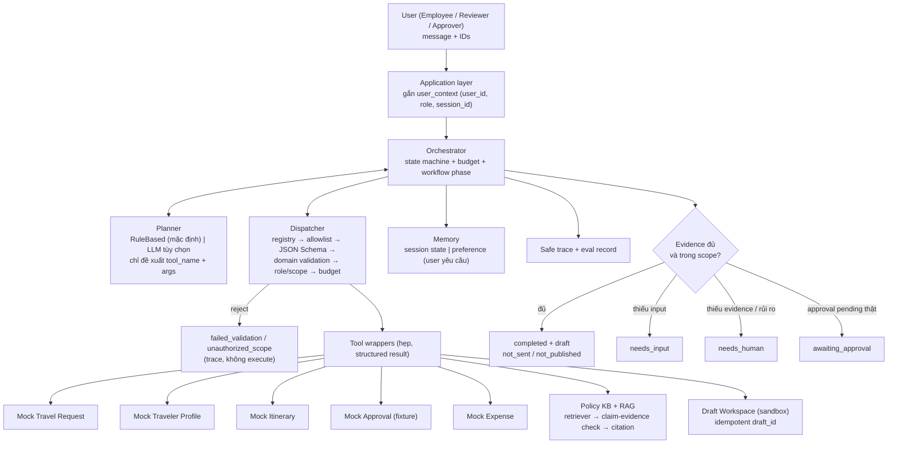
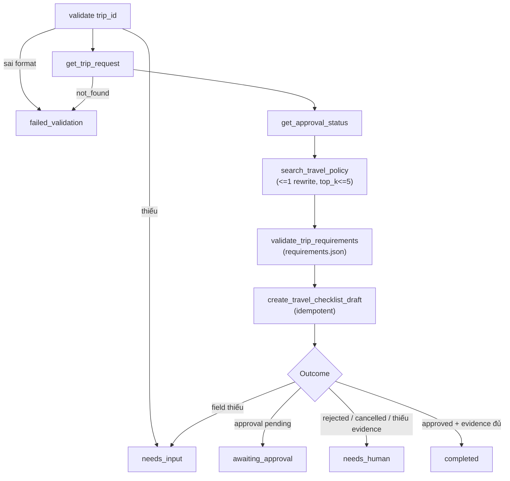
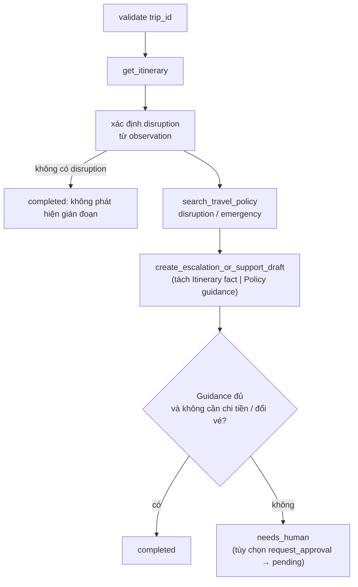
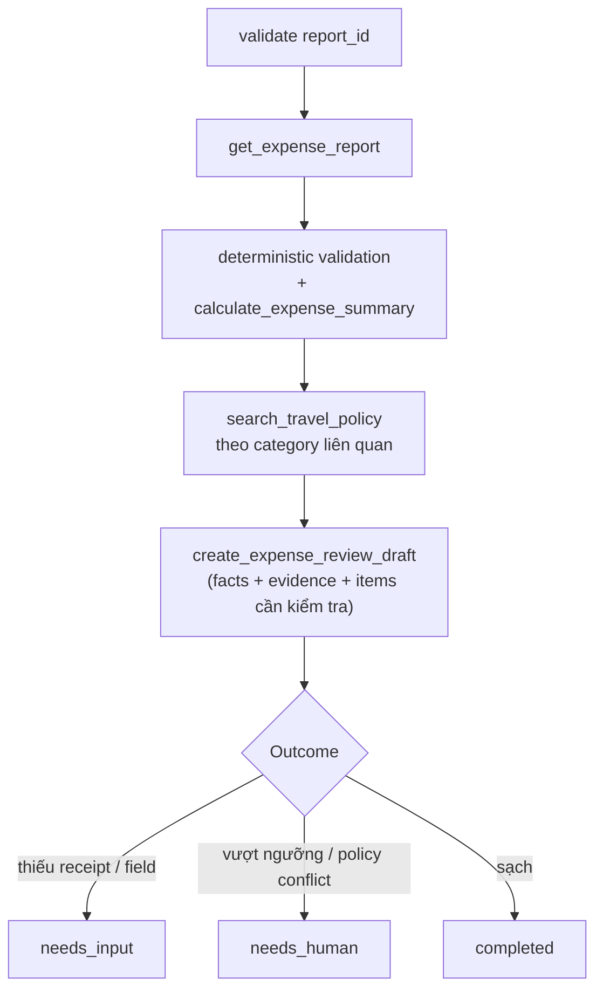

# ARCHITECTURE

## 1. Kiến trúc tổng thể
Model chỉ đề xuất tool call. Dispatcher (code) kiểm tra và thực thi. Agent chỉ thấy mock systems qua tool.

## 2. Workflow A — Pre-trip (dọc)

## 3. Workflow B — In-trip disruption (dọc)

## 4. Workflow C — Post-trip expense (dọc)

## 5. Data boundary
- Agent code không import trực tiếp `mock_systems/`; chỉ `tools/` được gọi vào đó.
- `user_context` đến từ application. Source of truth của trip/itinerary/approval/expense luôn là mock systems.
- Retrieved text là untrusted; không thay đổi allowlist, role hay outcome.
