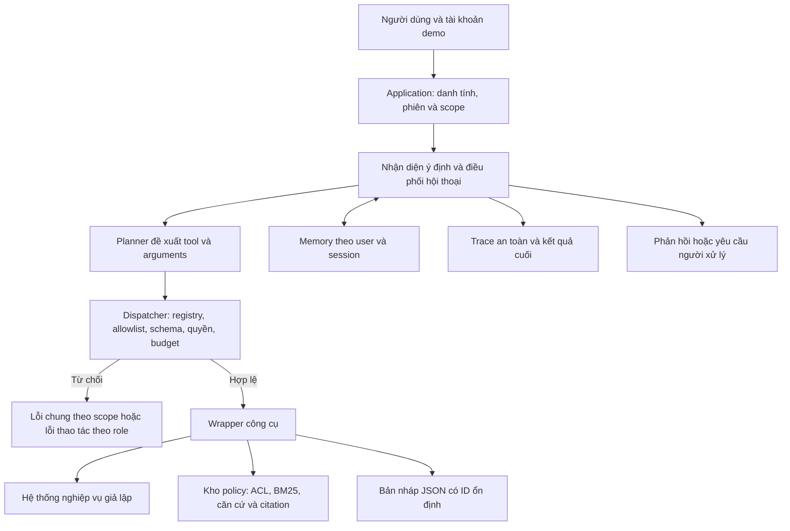
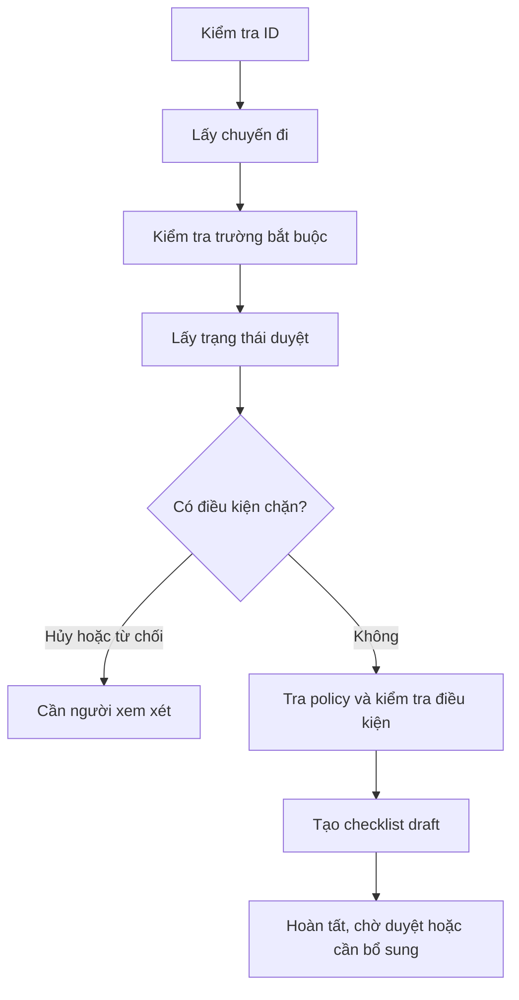
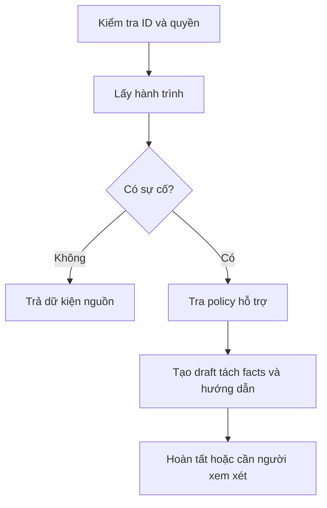
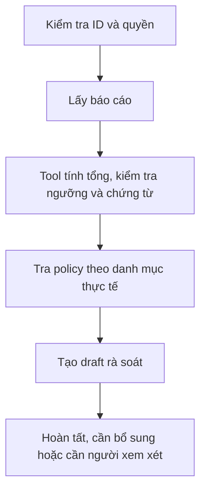

# Kiến trúc hệ thống

## 1. Luồng tổng thể

Model hoặc planner chỉ đề xuất lời gọi. Application gắn danh tính; dispatcher xác thực; tool là ranh giới đọc/ghi dữ liệu nghiệp vụ giả lập. Memory hỗ trợ nối hội thoại và không thay thế nguồn nghiệp vụ.

`nlu.py` nhận diện mẫu Anh–Việt, ID/ngày/điểm đến và bốn tuyến. `conversation.py` chọn nhánh theo role, nối ngữ cảnh, chạy workflow và định dạng. `orchestrator.py` đếm lần thử, retry và ghi trace; `dispatcher.py` kiểm tra lời gọi trước khi thực thi. `errors.py` tập trung cách diễn đạt lỗi.

## 2. Quy trình A: trước chuyến đi

ID sai, không có hồ sơ, ngoài quyền và lỗi tool dừng ở nhánh tương ứng. Trạng thái pending chỉ được phản ánh khi nguồn thực sự trả pending. Thiếu căn cứ/xung đột cần người xử lý.

## 3. Quy trình B: trong chuyến đi

## 4. Quy trình C: sau chuyến đi

## 5. Ranh giới dữ liệu và quyền

Agent không đọc file nghiệp vụ tùy ý. Application có quyền đọc danh tính, trạng thái giao diện và ghi log; tool wrapper gọi mock systems. Context gồm `user_id`, `role`, `session_id`, có thể thêm `approval_scope` đang pending. Model không được tự khai danh tính trong arguments.

Employee chỉ thấy hồ sơ của mình; Reviewer rà soát dữ liệu được cấp; Approver chỉ đọc đúng loại facts và policy phục vụ scope; Admin chỉ có tool đọc tổng quan/audit. Các API web áp dụng quyền riêng ở server, không chỉ ẩn nút trên giao diện.

## 6. RAG, approval và audit

`request_approval` dành cho Employee sở hữu chuyến, tạo pending không trùng theo cặp ID/action. Quyết định do helper bên ngoài tool set ghi cùng audit có người thực hiện, lý do, thời điểm và run ID.

Kho policy lọc `allowed_roles` trước chấm BM25, phân tích phiên bản và citation. Approver còn bị giới hạn danh mục theo action. Thiếu evidence hoặc xung đột không được biến thành câu trả lời completed.

Hội thoại có bốn tuyến: `SELF_SERVE`, `CLARIFY`, `HANDOFF_STAFF`, `REJECT_SAFETY`. Handoff ghi phiếu mô phỏng trong CSV, không đồng nghĩa đã gửi cho người thật. Trace và CSV hội thoại tách biệt khỏi audit nghiệp vụ.
